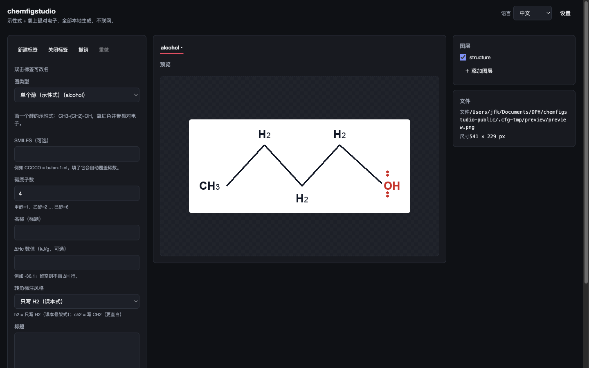
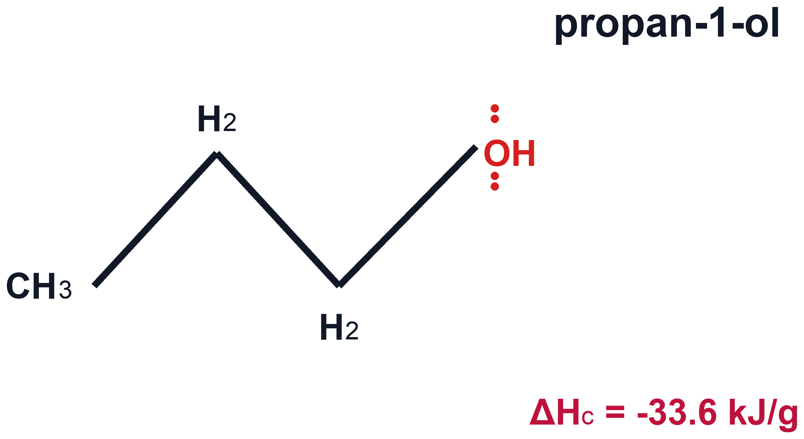
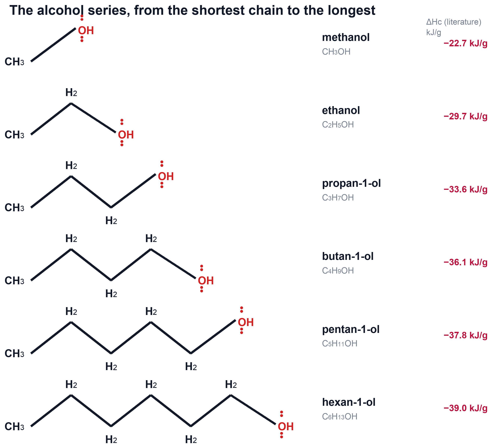
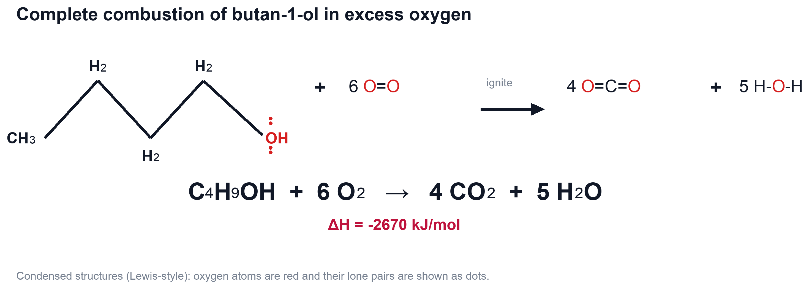
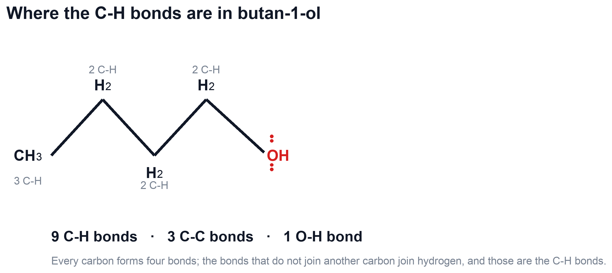
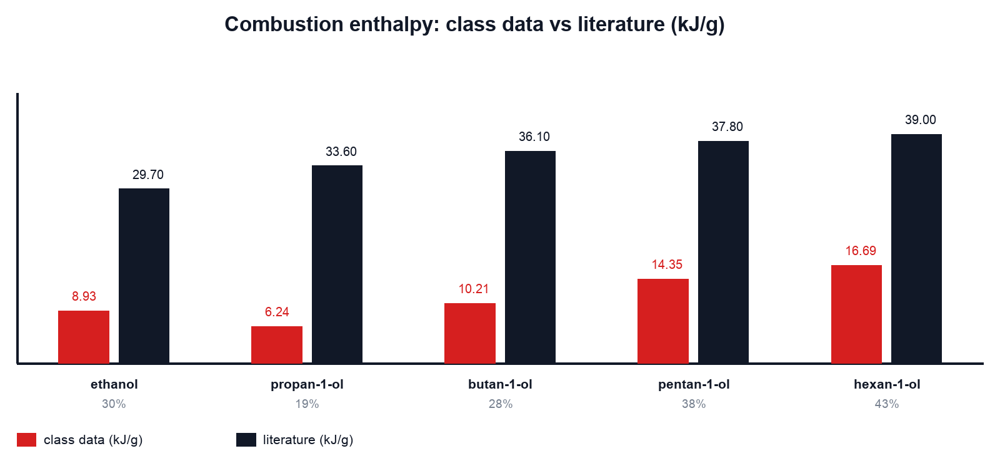
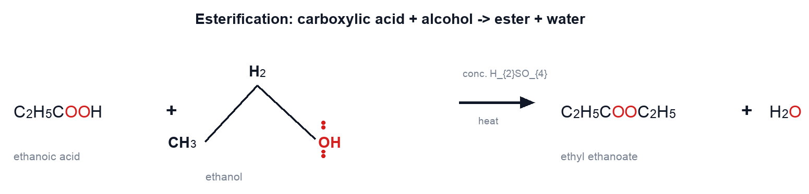
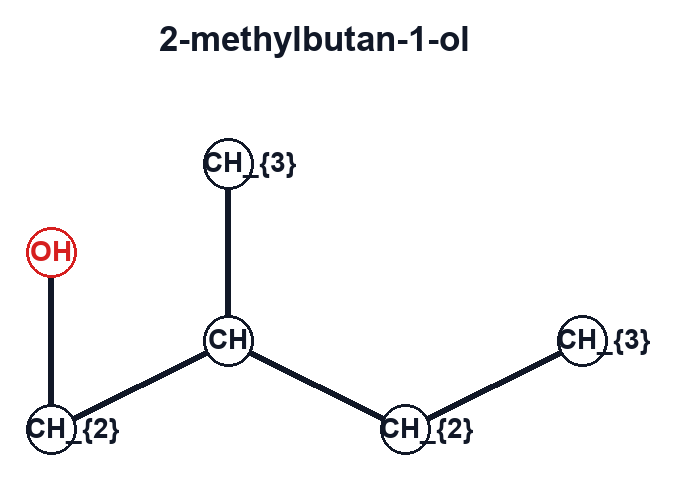

# chemfigstudio

**Condensed-formula chemistry figures, generated locally.** No network, no browser
engine, no third-party drawing app — one small Python package and Pillow.



*Local web GUI (1440×900). Dark mode ships too — see `docs/images/gui-dark.png`.*

**Repository:** https://github.com/Tracecatalyst/chemfigstudio


---

## What it draws

Seven figure types, all reproducible from a command or one API call:

| Figure | What it shows | Preview |
|---|---|---|
| `alcohol` | one straight-chain alcohol: condensed structure, name, formula, literature ΔHc |  |
| `series` | many alcohols row by row, for "longer chain → more heat per gram" reasoning |  |
| `reaction` | complete combustion, **auto-balanced** from the carbon count, with ΔH |  |
| `chcount` | every corner labelled with its C–H count (3 C–H / 2 C–H …) |  |
| `enthalpy` | class measurements vs literature, bar chart with % deviation |  |
| `esterification` | carboxylic acid + alcohol → ester + water |  |
| `skeleton` | an editable atom/bond graph (rings, branches, N/S/Cl/Br/P) |  |

## Why this exists

- **Fully local.** Nothing leaves the machine; the tool works offline in an exam room.
- **Deterministic.** Same input → byte-identical PNG. The test suite pins hashes, so
  refactors cannot silently change a figure you already published.
- **Vector when you want it.** `--format svg` emits a real SVG whose labels are real
  `<text>` (searchable, selectable, scalable), not outlined paths.
- **No chemistry toolkit required** for straight-chain alcohols. If RDKit is present,
  it is used automatically for branched/ring/exotic SMILES.
- **Bilingual UI and messages** (English / 简体中文) with a key-parity test.

## Install

Requires Python 3.9+ and Pillow. Nothing is installed system-wide:

```bash
git clone https://github.com/Tracecatalyst/chemfigstudio.git && cd chemfigstudio
PIP_USER=1 python3 -m pip install --user pillow      # if you do not have Pillow yet
make test                                            # 278 tests, hermetic (no network)
```

## Quick start

### 1. Web GUI

```bash
make gui            # starts http://127.0.0.1:8756 and opens it
```

The GUI has three columns: **parameters** on the left, the **canvas** in the middle,
**layers / output** on the right. Typing in a parameter re-renders the preview
immediately; `Generate` writes the file; `Show in Finder` reveals it.

Each document is a **tab**. `New tab` opens another figure, clicking a tab switches
documents (parameters and preview follow), `Close tab` drops it, and double-clicking a
tab renames it. Undo/redo steps through a 100-deep history per tab.

### 2. Command line

```bash
cd tools/chemfigstudio                       # or wherever you cloned it
PYTHONPATH=src python3 -m chemfigstudio.cli alcohol --n 4 --name butan-1-ol --dh -36.1
PYTHONPATH=src python3 -m chemfigstudio.cli series --include-methanol -o series.png
PYTHONPATH=src python3 -m chemfigstudio.cli reaction --n 4 --dh-mol -2670 --dpi 300
PYTHONPATH=src python3 -m chemfigstudio.cli list
```

Every subcommand accepts `--format png,svg`, `--dpi`, `--transparent`, `--json` (machine
readable result) and writes into the output directory shown by the GUI footer.

### 3. Python API

```python
import sys; sys.path.insert(0, "src")
from chemfigstudio import api

result = api.render("reaction", out="combustion.png",
                    params={"n_carbons": 4, "delta_h_kj_per_mol": -2670},
                    formats=("png", "svg"), dpi=300)
print(result.size, result.warnings)
```

## Editing a skeleton

`Edit skeleton…` opens the atom/bond editor: click to add a carbon, click a bond to
cycle single → double → triple, pick an element from the palette, drop functional
groups, then `Apply` to push the graph through the same renderer. `skeleton` accepts the
graph as JSON, so an editor session is reproducible in a script:

```bash
PYTHONPATH=src python3 -m chemfigstudio.cli skeleton \
  --skeleton '{"atoms":[{"id":"a","element":"C","x":100,"y":100}],"bonds":[]}'
```

## Batch

`Batch…` takes a CSV (`kind,param,param,…`) and renders every row, reporting per-row
errors instead of stopping. Useful for a class set of alcohols:

```csv
kind,smiles,name,delta_h
alcohol,CO,methanol,-22.7
alcohol,CCO,ethanol,-29.7
```

## Export

`Export image…` writes PNG / SVG / PDF, optionally transparent, at a chosen DPI, and
refuses to overwrite an existing file unless you confirm.

## Plugins

Drop a Python module into your plugins directory and it can register extra figure
kinds (`chemfigstudio_plugin_entry`). `CHEMFIG_PLUGINS=off` disables loading; bundled
examples live in `plugins/`.

## macOS app (optional)

```bash
make app                 # dist/ChemFigStudio.app   (current arch)
make bundle-universal    # Intel + Apple Silicon
```

The app is a thin Swift/WKWebView shell around the same local server. It is unsigned
(no developer certificate), so the first launch needs the usual Gatekeeper detour.

## Development

```bash
make lint        # ruff
make typecheck   # mypy
make test        # 278 unit tests, hermetic
make browser-check   # 21 end-to-end UI checks in a real browser
make ui-shots    # multi-width layout assertions + screenshots
```

Every fix lands with a test in the same commit, and rendering refactors are proven by
byte-comparison against the previous output.

## Limitations

- The built-in SMILES parser only understands straight-chain primary alcohols; install
  RDKit for anything else.
- `series` rows are literature-fixed unless you pass `--include-methanol` or `--entries`.
- The macOS app is unsigned.

## License

MIT — see [LICENSE](LICENSE).
